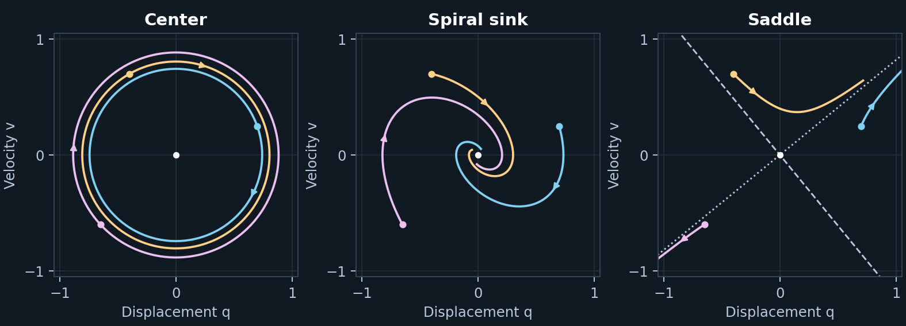

# Flows, equilibria, and linearization

A bead released near the bottom of a smooth track oscillates. Add a small brake and it settles to the bottom. Turn the track upside down and a small displacement sends the bead away. At the release point, the bead can have the same instantaneous velocity in all three trials. Its subsequent motion depends on the position, the force law, and the damping. A state description must preserve enough information to distinguish those futures.

Use a dimensionless bead model throughout this chapter. The signed displacement is $q$, its velocity is $v$, and overdots mean differentiation with respect to dimensionless time $t$. A smooth potential $U(q)$ and a nonnegative damping constant $\gamma$ specify the acceleration by $-U'(q)-\gamma v$. The potential controls the restoring force and the brake removes mechanical energy. This model lets us ask what can be established from the equations before computing a single long trajectory.

## A state closes the evolution law [L1 09:00](https://www.youtube.com/watch?v=nh4TFzg30eQ&t=540s)

Let $\Omega\subseteq\mathbb R^n$ be an open set of admissible states. For a continuous-time deterministic model, the state $z\in\Omega$ evolves according to $\dot z=F(z)$, where the vector field $F:\Omega\to\mathbb R^n$ assigns a velocity to each state. It is **autonomous** because $F$ depends only on the current state. The initial value problem specifies the additional datum $z(0)=z_0$.

For the bead, take $z=(q,v)$ and obtain
$$
\dot q=v,\qquad \dot v=-U'(q)-\gamma v.
$$

This first-order pair is equivalent to the scalar second-order equation $\ddot q=-U'(q)-\gamma\dot q$. One must supply two initial numbers, $q(0)$ and $v(0)$, whichever form is used. In particular, $q(0)=0$ alone cannot predict whether the bead stays at the bottom. If $U'(0)=0$ and $v(0)=0$ it stays there. If $v(0)\ne0$, its instantaneous position derivative already distinguishes the two cases.

A **discrete-time** model instead advances a state by an update $z_{k+1}=M(z_k)$, where $M$ maps the state space to itself and $k$ is an integer step number. Specifying a deterministic update makes the future unique by composition. The update can send distinct states to the same next state, for example $M(q)=q^2$ on $[-1,1]$. The state space can also be infinite-dimensional. An ideal vibrating string needs the displacement and velocity at each position along the string. The bead and the other ordinary differential equations in the first part of the course use finite-dimensional states.

A differential equation with an applied time-dependent force has the form $\dot z=F(t,z)$. Introduce a clock state $s$ with $\dot s=1$ and set $\dot z=F(s,z)$. With $s(0)=0$, uniqueness gives $s(t)=t$ and recovers the original evolution. For a force that depends periodically on time with period $T>0$, the clock can live on the circle of times modulo $T$. This choice keeps the drive phase while identifying times with identical forcing. In the projected $(q,v)$ plane, trajectories from distinct phases can meet at the same state and then diverge. The augmented state distinguishes the phases that determine their derivatives. [Lecture 1, time dependence](https://www.youtube.com/watch?v=nh4TFzg30eQ&t=1124s).

## Uniqueness determines the geometry of trajectories [L1 25:21](https://www.youtube.com/watch?v=nh4TFzg30eQ&t=1521s)

Suppose $F$ is continuously differentiable near $z_0$. On a small closed ball in that neighborhood its derivative is bounded, so the mean value estimate makes $F$ locally Lipschitz: $\|F(a)-F(b)\|\le L\|a-b\|$ there for a finite $L$ and the Euclidean norm $\|\cdot\|$. The local existence and uniqueness theorem then gives a solution through $z_0$ for sufficiently short positive and negative times. The solution satisfies the integral equation
$$
z(t)=z_0+\int_0^t F(z(s))\,ds.
$$

For uniqueness, subtract the integral equations of two solutions with the same start. On an interval of length $h$ during which both stay in the ball, their maximum distance is bounded above by $Lh$ times that same maximum. Choosing $h$ with $Lh<1$ forces the maximum to vanish. Reapplying the argument at their common endpoints proves uniqueness throughout their common connected time interval. The standard contraction proof of existence uses the same estimate and chooses $h$ small enough for the integral operator to send the ball of candidate paths into itself. [Teschl, *Ordinary Differential Equations and Dynamical Systems*, Chapter 2](https://www.mat.univie.ac.at/~gerald/ftp/book-ode/ode.pdf).

Write $\Phi_t(z_0)$ for the state reached from $z_0$ after time $t$, where the solution exists. On its common domain, the flow obeys $\Phi_{t+s}(z_0)=\Phi_t(\Phi_s(z_0))$. Indeed, shifting a solution by $s$ gives a solution of the same autonomous equation with initial state $\Phi_s(z_0)$. Uniqueness identifies it with the right-hand side. In particular $\Phi_{-t}$ undoes $\Phi_t$ on its image. A **trajectory** is the set of states traced by one solution, with an orientation given by increasing time. When two solutions meet at times $t_1$ and $t_2$, translate both time origins to their meeting point and use uniqueness. They belong to the same maximal trajectory. If a nonconstant trajectory returns to the same state after time $T>0$, the composition law repeats that segment with period $T$. The constant solutions deserve their own name, **equilibria**.

The hypotheses matter. For $\dot q=\sqrt{|q|}$ with $q(0)=0$, the identically zero solution and the solution equal to zero through time $a\ge0$ and $(t-a)^2/4$ thereafter both satisfy the equation for $t\ge0$. The slope of the right-hand side with respect to $q$ is unbounded near zero. The rule assigns a velocity at each position, but the initial value problem admits many futures.

A local flow can also end after a finite time even when uniqueness holds. For $\dot q=q^2$, differentiating $1/q$ gives $-1$ wherever $q\ne0$. Thus
$$
q(t)=\frac{q_0}{1-tq_0}
$$
for initial condition $q_0\ne0$ on the interval containing zero before the denominator vanishes. For $q_0>0$ the solution escapes all bounded sets as $t\uparrow1/q_0$. For $q_0<0$ it approaches zero as $t\to\infty$. The polynomial field is smooth on the whole line. Smoothness gives local solutions and leaves open whether every solution exists for every time. [Lecture 2, the degenerate zero](https://www.youtube.com/watch?v=Qoi5Vs50WVU&t=1948s).

## Local coordinates and first integrals answer different questions [L1 36:06](https://www.youtube.com/watch?v=nh4TFzg30eQ&t=2166s)

A point $z_0$ with $F(z_0)\ne0$ is **regular**. Near such a point, choose an $(n-1)$-dimensional surface transverse to the velocity, so its tangent plane together with $F(z_0)$ spans $\mathbb R^n$. Parameterize that surface by $u$ and let $a(u)$ be its point with label $u$. The map $(s,u)\mapsto\Phi_s(a(u))$ has an invertible derivative at $(0,u_0)$. Its derivative in the $s$ direction is $F(z_0)$, and the remaining directions span the surface tangent plane. The inverse function theorem gives local coordinates $(s,u)$ in which the evolution advances $s$ at unit speed and leaves $u$ fixed. This is the mechanism of the flow-box theorem. The chart requires nonzero velocity and describes a neighborhood, with no guarantee that the same transverse surface can label every trajectory globally.

A differentiable **first integral** $I:\Omega\to\mathbb R$ is constant along trajectories. By the chain rule its derivative along the flow is $\nabla I(z)\cdot F(z)$, with $\nabla I$ the column of partial derivatives. Vanishing of this expression throughout $\Omega$ establishes the conservation law. For the bead, define $E(q,v)=v^2/2+U(q)$. Then
$$
\dot E=v(-U'(q)-\gamma v)+U'(q)v=-\gamma v^2.
$$

With $\gamma=0$, each initial state determines an energy level and its trajectory lies on that level. If $U(q)=q^2/2$, the positive energy levels are circles in the $(q,v)$ plane. The constant-energy circle of radius $\sqrt{2E}$ gives the maximum displacement, even before solving the time evolution. With $\gamma>0$, the energy decreases whenever the bead moves. A nonconstant periodic orbit would require its net change over one period to be zero. The integrated balance gives $-\gamma\int_0^T v^2\,dt<0$ on such an orbit, a contradiction.

For $k$ independent first integrals, the level constraints locally reduce dimension from $n$ to $n-k$ at a point where their gradients have rank $k$. This is a direct application of the implicit function theorem. At rank loss the count can fail. For example, the quadratic bead energy has zero gradient at the origin and the zero-energy level is a single point. The rank count also leaves topology and time parameterization open. Later Hamiltonian chapters use a different integrability criterion involving mutually commuting first integrals. A short list of familiar conserved quantities alone cannot prove nonintegrability or chaos.

For the many-particle preview, let particle $i$ have position $r_i\in\mathbb R^3$, mass $m_i>0$, and momentum $p_i=m_i\dot r_i$. Each pair potential depends only on the interparticle distance $\|r_i-r_j\|$, and there are no external forces. Pair forces cancel in the sum, so $P=\sum_i p_i$ is constant. Each pair contributes zero net torque because its force is parallel to the separation vector. Therefore $\sum_i r_i\times p_i$ is constant. Let $M=\sum_i m_i$ and $R=\sum_i m_i r_i/M$. Since $\dot R=P/M$, the three components of $R-tP/M$ are constants with explicit time dependence in the original phase coordinates. They can be viewed as functions on the clock-extended state. Treating them as three more time-independent functions on the original phase space would give the wrong dimension count. [Lecture 1, symmetries and conserved quantities](https://www.youtube.com/watch?v=nh4TFzg30eQ&t=2941s). [Lecture 2, center of mass](https://www.youtube.com/watch?v=Qoi5Vs50WVU&t=163s).

## Find scalar equilibria before solving the equation [L2 08:25](https://www.youtube.com/watch?v=Qoi5Vs50WVU&t=505s)

An equilibrium $z_*$ satisfies $F(z_*)=0$. It is **Lyapunov stable** if, for every prescribed neighborhood radius $\varepsilon>0$, some radius $\delta>0$ ensures that every solution starting within $\delta$ stays within $\varepsilon$ for all forward time. An equilibrium is **locally asymptotically stable** if it is Lyapunov stable and attracts all starts in some neighborhood as $t\to\infty$. Attraction from one side alone is insufficient for this definition on an open interval.

For a scalar equation $\dot q=f(q)$, arrows on a **phase line** point right where $f>0$ and left where $f<0$. Between consecutive zeros the sign is fixed by continuity. For a simple zero $q_*$, differentiability gives $f(q_*+u)=f'(q_*)u+o(|u|)$, where the remainder divided by $|u|$ tends to zero as $u\to0$. If $f'(q_*)<0$, both arrows point inward. A nearby trajectory is monotone and bounded by the equilibrium, so it has a limit. A nonzero speed at that limit would force it to keep moving, hence the limit is the sole zero in the neighborhood. The order on the line gives stability as well as attraction. If $f'(q_*)>0$, the nearby trajectories move away and exit any sufficiently small interval around the root.

A **degenerate** scalar zero has $f'(q_*)=0$. The fields $-q^3$, $q^3$, and $q^2$ share the same zero derivative at zero. Their signs give, respectively, attraction from both sides, repulsion from both sides, and attraction from the left with repulsion from the right. The leading nonlinear term decides the classification. For the family $f_\mu(q)=q(q-\mu)$ with real control parameter $\mu$, the equilibria are $0$ and $\mu$, with slopes $-\mu$ and $\mu$. The branches exchange stability across $\mu=0$ at a **transcritical bifurcation**. At equality the field is $q^2$, which makes the two one-sided behaviors explicit. This model has two crossing branches. A constant perturbation $q^2-\mu$ instead gives two equilibria, one double equilibrium, or none as $\mu$ passes from positive to zero to negative. The distinction depends on how the model is perturbed. [Lecture 2, the exchange of stability](https://www.youtube.com/watch?v=Qoi5Vs50WVU&t=1355s).

Topology also belongs in the model. For $\dot q=\sin q$ on the real line, the equilibria are all $q=k\pi$ for integer $k$, alternating repellers and attractors because $f'(k\pi)=(-1)^k$. If the state is an angle modulo $2\pi$, those same equations describe exactly two equilibria on a circle. The local classification is unchanged, while the number of distinct states differs. [Lecture 2, sine flow](https://www.youtube.com/watch?v=Qoi5Vs50WVU&t=2180s).

## Linearization gives a local model for coupled variables [L2 39:58](https://www.youtube.com/watch?v=Qoi5Vs50WVU&t=2398s)

For an $n$-component field $F$ that is continuously differentiable near an equilibrium $z_*$, define the perturbation $w=z-z_*$. Define the **Jacobian** $A=DF(z_*)$ by entries $A_{ij}=\partial F_i/\partial z_j$ evaluated at $z_*$. The first-order expansion yields $\dot w=Aw+r(w)$ with $\|r(w)\|/\|w\|\to0$ as $w\to0$. If $A$ is invertible, the inverse function theorem makes $z_*$ the only equilibrium in some neighborhood. A singular $A$ leaves isolation undetermined. The two scalar fields $f(q)=q^2$ and $f(q)=0$ have the same derivative at zero and different sets of equilibria. [Lecture 2, singular linearizations](https://www.youtube.com/watch?v=Qoi5Vs50WVU&t=3243s)

The series $e^{tA}=\sum_{j=0}^\infty t^j A^j/j!$, using $A^0$ equal to the identity, converges on any bounded time interval by comparison with $e^{|t|\|A\|}$ for a matrix norm satisfying $\|AB\|\le\|A\|\|B\|$. Differentiation term by term gives $d(e^{tA})/dt=Ae^{tA}$, hence the linear model's solution is $w(t)=e^{tA}w(0)$.

For a planar instance write $\dot x=ax+by$ and $\dot y=cx+dy$, with real coefficients $a,b,c,d$. Differentiating the first equation gives $\ddot x=a\dot x+b(cx+dy)$. Substitute $by=\dot x-ax$ to get
$$
\ddot x=(a+d)\dot x-(ad-bc)x.
$$
If $b\ne0$, recover $y=(\dot x-ax)/b$ and check the second state equation. The scalar equation then encodes both state variables through $x(0)$ and $\dot x(0)$. If $b=0$, the measured $x$ evolves independently of $y$ and its record cannot recover $y(0)$. The matrix exponential works in both cases. [Lecture 2, eliminating a component](https://www.youtube.com/watch?v=Qoi5Vs50WVU&t=3000s)

An eigenvalue $\lambda$ with eigenvector $b\ne0$ satisfies $Ab=\lambda b$. If $w(0)=b$, then $e^{tA}b=e^{\lambda t}b$ by the power series. For a real matrix, a nonreal conjugate pair gives real oscillatory modes with growth or decay at the common real part. A repeated eigenvalue may have too few independent eigenvectors. For example let $A=\lambda I+N$, with $I$ the identity, $N\ne0$, and $N^2=0$. Since $N$ and $I$ commute,
$$
e^{tA}=e^{t\lambda}(I+tN).
$$
The polynomial factor changes finite-time growth while preserving eventual decay when $\lambda<0$.

For the bead, set $U'(0)=0$ and write $\kappa=U''(0)$ for the curvature. Then
$$
A=\begin{pmatrix}0&1\\-\kappa&-\gamma\end{pmatrix},
\qquad \det(\lambda I-A)=\lambda^2+\gamma\lambda+\kappa.
$$
For $\gamma>0$ and $\kappa>0$, both roots have negative real part by their sum and product, or by the quadratic formula. For $\kappa<0$, their product is negative, so there is one positive and one negative real root. For $\kappa>0$ and $\gamma=0$ the roots are purely imaginary. The quadratic bead potential gives an exact center in that case, with each nearby positive-energy orbit closed.

A **hyperbolic** equilibrium has no eigenvalue with zero real part. The Hartman–Grobman theorem transfers the local attracting, repelling, or saddle structure of its linear model to the nonlinear system under the smoothness hypotheses above. The equivalence concerns local orbit structure. It gives no global basin boundary or exact trajectory formulas. With an eigenvalue on the imaginary axis, inspect the nonlinear terms or use an independent argument such as the energy balance. [Chapter 2](ch02.html) develops the planar classification and the invariant curves through a saddle. [Teschl, §9.3](https://www.mat.univie.ac.at/~gerald/ftp/book-ode/ode.pdf).

<figure markdown="1">

<figcaption>The curves are computed from the exact linear flow. The saddle's dashed line is the stable eigendirection and the dotted line is the unstable eigendirection. Only starts on the stable line approach the saddle in forward time.</figcaption>
</figure>

## Laboratory

Run [the exact-flow laboratory](../code/ch01.py) with Python. It checks the flow law and energy of the quadratic bead, then evaluates the critically damped closed form at $t=1$ and checks the predicted position and velocity. Its last check shows the finite-time growth of the scalar flow near its maximal existence boundary. These checks use fixed synthetic states and require no data files.

## Exercises

1. **State sufficiency.** A linear spring is driven by a periodic force $a\cos(\omega t)$ with amplitude $a\ne0$ and angular frequency $\omega>0$. Write a first-order autonomous model. Explain why equal projected states can give different accelerations.
2. **Compute.** Find the interval of existence containing $t=0$ for $\dot q=q^2$ with $q(0)=-2$. Explain what happens in forward time.
3. **Proof.** A positive-period trajectory is claimed for the damped unforced bead. Use the energy integral to decide whether it can move.
4. **Counterexample.** Compare $\dot q=-q^3$ and $\dot q=q^3$ at zero. Derive their solutions for a nonzero start up to the first possible pole.
5. **Spectral calculation.** For $\gamma=2$ and $\kappa=1$, derive $e^{tA}$ and predict $q(1)$ starting from $q(0)=0$, $v(0)=1$.
6. **Hypothesis check.** Why does a local rectification chart give no trivial solution for every initial condition of the bead? Identify the failure at $q=v=0$ and the global obstruction on a closed orbit.

Worked solutions

1. Take $\dot q=v$, $\dot v=-\kappa q+a\cos\theta$, and $\dot\theta=\omega$ with phase $\theta$ modulo $2\pi$. At the same $(q,v)$ the phases $0$ and $\pi$ contribute opposite forces, differing by $2a$. A unique projected vector field cannot assign both accelerations to that state.
2. Substitution gives $q(t)=-2/(1+2t)$ on $(-1/2,\infty)$. The pole is in the past. Forward in time the negative state increases toward zero and stays strictly negative at every finite time. Its asymptotic approach is of order $1/t$.
3. Periodicity yields $E(T)-E(0)=0$. If $\gamma>0$, integration gives $\int_0^T v^2\,dt=0$. Continuity forces $v=0$ throughout. Hence $q$ is constant and the second state equation gives $U'(q)=0$. Such a trajectory is an equilibrium.
4. For nonzero $q$, differentiating $q^{-2}$ gives $2$ for the attracting field and $-2$ for the repelling field. Retaining the start's sign gives $q(t)=q_0/\sqrt{1+2q_0^2t}$ and $q(t)=q_0/\sqrt{1-2q_0^2t}$, respectively, for positive denominators. The first tends to zero. The second escapes in finite positive time. Both linearizations have the same zero slope.
5. Here $A+I=N$ has rows $(1,1)$ and $(-1,-1)$, so $N^2=0$. The formula $e^{-t}(I+tN)$ sends the starting vector $(0,1)^T$ to $(te^{-t},(1-t)e^{-t})^T$. Thus $q(1)=e^{-1}$ and $v(1)=0$. The trajectory reaches its maximum positive displacement there.
6. At the origin the velocity is zero, so the time direction supplies no independent derivative column for the coordinate map. Along a nonconstant closed orbit, repeatedly advancing a real time coordinate cannot return to the same coordinate value after a full period. A locally invertible parameterization can cover a segment while a single real time coordinate fails around the whole loop.

