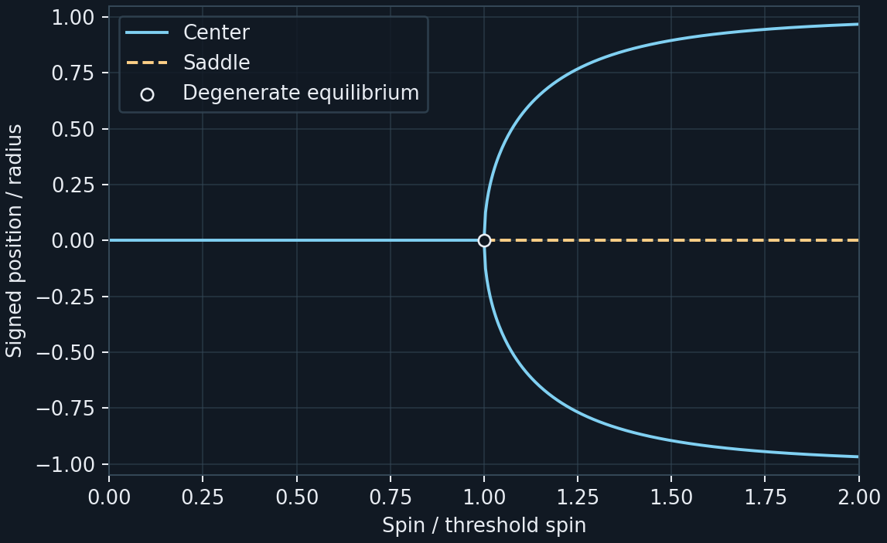

# The rotating hoop and routes to complex dynamics

A frictionless bead sits on a vertical wire hoop that spins about its vertical diameter. A bead at the bottom can remain there at any spin speed, but a small displacement may grow beyond a critical speed. For someone designing the apparatus, the questions are where the bead can remain at rest relative to the hoop, which positions withstand perturbations, and how long small oscillations take. The same experiment also gives a clean contrast between regular motion and the more complicated dynamics possible when the state space or forcing changes.

## From the rotating constraint to an effective potential [L15 06:21](https://www.youtube.com/watch?v=8qbR7SsJB9U&t=381s)

Let $m>0$ be the bead mass, $R>0$ the hoop radius, $g>0$ gravitational acceleration and $\Omega\ge0$ the prescribed angular speed. Take $\theta$ as the signed angle along the hoop from its bottom. Let $t$ denote time. In a fixed Cartesian frame the position has coordinates

$$
x=R\sin\theta\cos(\Omega t),\quad
y=R\sin\theta\sin(\Omega t),\quad
z=R(1-\cos\theta).
$$

The tangential velocity from changing $\theta$ is perpendicular to the azimuthal velocity from rotating the hoop. The squared speed is therefore $R^2\dot\theta^2+\Omega^2R^2\sin^2\theta$. Substitute this relation into the Lagrangian, kinetic minus gravitational potential:

$$
L(\theta,\dot\theta)=\frac{mR^2}{2}\dot\theta^2-U(\theta),\qquad
U(\theta)=mgR(1-\cos\theta)-\frac{m\Omega^2R^2}{2}\sin^2\theta .
$$

The Euler–Lagrange equation $d(L_{\dot\theta})/dt=L_\theta$ now gives $mR^2\ddot\theta=-U'(\theta)$. This step keeps the energy contribution from the driven azimuthal motion in the effective potential. If one drops that contribution before varying $L$, the predicted restoring force would be independent of $\Omega$.

The conjugate momentum is $p_\theta=mR^2\dot\theta$. The reduced Hamiltonian is $p_\theta^2/(2mR^2)+U(\theta)$, which remains constant because the reduced $L$ is independent of time. The bead's laboratory-frame mechanical energy adds, instead of subtracting, the azimuthal kinetic term. The motor maintaining $\Omega$ can perform work on the bead through the moving constraint. The conserved reduced energy thus has a precise meaning tied to the constrained coordinate.

On the lower half of the hoop the signed horizontal coordinate is $\rho=R\sin\theta$, with $z=R-\sqrt{R^2-\rho^2}$. In this chart $R^2\dot\theta^2=R^2\dot\rho^2/(R^2-\rho^2)$. The conjugate momentum becomes $p_\rho=mR^2\dot\rho/(R^2-\rho^2)$ and the kinetic term in the Hamiltonian becomes $(R^2-\rho^2)p_\rho^2/(2mR^2)$. The apparently divergent coordinate inertia as $|\rho|\to R$ is a property of the chart, where $d\rho/d\theta$ vanishes. The angle coordinate stays regular there. [L15 23:00](https://www.youtube.com/watch?v=8qbR7SsJB9U&t=1380s)

## Compute the symmetry-breaking threshold and its scaling [L15 30:55](https://www.youtube.com/watch?v=8qbR7SsJB9U&t=1855s)

With $\omega_0=\sqrt{g/R}$, equilibrium relative to the hoop requires $\dot\theta=0$ and

$$
U'(\theta)=mR^2\sin\theta(\omega_0^2-\Omega^2\cos\theta)=0.
$$

The bottom $\theta=0$ and top $\theta=\pi$ always exist. Their effective curvatures divided by $mR^2$ are $\omega_0^2-\Omega^2$ and $-\omega_0^2-\Omega^2$, respectively. With positive inertia, positive curvature makes small disturbances oscillatory and the effective energy minimum ensures Lyapunov stability. Negative curvature gives a saddle in the plane $(\theta,\dot\theta)$. The top remains a saddle. The bottom switches from a center to a saddle as $\Omega$ passes $\omega_0$.

For $\Omega>\omega_0$, two distinct equilibria satisfy $\cos\theta_*=\omega_0^2/\Omega^2$. At either one, $U''(\theta_*)=mR^2\Omega^2\sin^2\theta_*>0$. They are centers in the frictionless system. In the $\rho$ coordinate, their signed positions are

$$
\rho_*=\pm R\sqrt{1-\left(\frac{\omega_0}{\Omega}\right)^4}.
$$

Using a nonnegative radius would merge the two branches. The signed coordinates expose the reflection symmetry $\theta\mapsto-\theta$, which produces the supercritical pitchfork of equilibria. As $\Omega$ becomes large, the new positions approach the equator with $\theta$ tending to $\pm\pi/2$. At the threshold, the angle equation has a leading cubic restoring term. Indeed, set $\Omega=\omega_0$ and expand near zero to obtain $U(\theta)/(mR^2)=\omega_0^2\theta^4/8+O(\theta^6)$, a flat local minimum. Linearization predicts zero oscillation frequency there, and the quartic term provides nonlinear stability.

<figure>
  
  <figcaption>The bottom equilibrium and the two new lower-half branches. The top equilibrium, always a saddle, also projects to zero signed horizontal coordinate and is omitted.</figcaption>
</figure>

For $\Omega<\omega_0$ the small-amplitude bottom period is $2\pi/\sqrt{\omega_0^2-\Omega^2}$. For $\Omega>\omega_0$ a side equilibrium has small-amplitude period $2\pi/\sqrt{\Omega^2-\omega_0^4/\Omega^2}$. If $\epsilon=\Omega/\omega_0-1>0$ is small, the side position scales as $|\rho_*|/R=2\sqrt\epsilon+O(\epsilon^{3/2})$ and the side frequency as $2\omega_0\sqrt\epsilon+O(\epsilon^{3/2})$. This is a statement about the small-amplitude period at fixed spin. At exactly $\Omega=\omega_0$, a small but finite amplitude $A$ has a period proportional to $1/A$. In the quartic approximation, solving the energy relation for the increasing branch gives

$$
T(A)=\frac{8}{\omega_0 A}\int_0^1\frac{du}{\sqrt{1-u^4}}.
$$

The integral is finite because the turning point at $u=1$ has a square-root singularity. The amplitude dependence supplies a period at the threshold even though the infinitesimal frequency vanishes. [L15 61:23](https://www.youtube.com/watch?v=8qbR7SsJB9U&t=3683s)

As an experimental check, a measured equilibrated angle would give $g=R\Omega^2\cos\theta_*$. The ideal relation assumes an exact circle, prescribed rate and no static bead friction. Position measurements near onset must also resolve the two branches. To see the geometric role of the constraint, replace the circle by a rigid parabola $z=k\rho^2/2$, where $k>0$ is inverse length. Its effective potential becomes $m(gk-\Omega^2)\rho^2/2$ and the coordinate inertia is $m(1+k^2\rho^2)$. Below $\sqrt{gk}$ the origin is a center, above it the origin is a saddle, and at equality every resting point is an equilibrium. The parabola has no positive quartic term to support off-axis branches. [L15 50:05](https://www.youtube.com/watch?v=8qbR7SsJB9U&t=3005s)

Adding viscous drag in the constrained direction makes the reduced energy decrease. As in [Chapter 6](ch06.html), sublevel trapping establishes stability at a minimum. Convergence then requires checking the largest invariant subset where the dissipative derivative is zero. In this context asymptotic stability means Lyapunov stability and local attraction together. Local attraction alone is a separate property.

## From periodic motion to quasiperiodic motion [L16 02:31](https://www.youtube.com/watch?v=FXJxdczeTpg&t=151s)

A nonconstant periodic trajectory of an autonomous flow satisfies $z(t+T)=z(t)$ for one $T>0$ and all $t$. By uniqueness, a return to the full state initiates a repetition. A turning point in the bead's first half-cycle has zero velocity but does not recreate the initial state in general. A scalar measurement can therefore recur earlier than the full phase point.

Imagine running two independent bead oscillations on identical mechanisms with adjustable frequencies $\omega_1,\omega_2>0$. At fixed nonzero amplitudes, their phases give coordinates on a two-torus, the product of two circles. In action-angle form these are $\theta_j(t)=\theta_j(0)+\omega_j t$ modulo $2\pi$. The combined flow repeats if both $\omega_j T$ are multiples of $2\pi$, or equivalently if $\omega_1/\omega_2$ is rational. For example, the ratio $3/2$ permits a repeat after three cycles of the faster oscillator and two of the slower. An irrational ratio gives a quasiperiodic trajectory. The return sequence to a fixed phase of oscillator 2 is rotation of phase 1 by $2\pi\omega_1/\omega_2$, and the multiples of an irrational rotation are dense in the circle.

For a completely integrable Hamiltonian with $n$ degrees of freedom, the Liouville–Arnold result applies on regular compact connected common levels of $n$ independent commuting first integrals. Such a level is an invariant $n$-torus, and the same phase argument holds for its constant frequency vector. Integral resonances yield lower-dimensional orbit closures. A general autonomous Hamiltonian has energy conservation, which restricts the motion to a $(2n-1)$-dimensional regular hypersurface. That restriction leaves room for several invariant regions and cannot by itself establish any whole-surface statistical law.

## Specify a measure before diagnosing mixing or chaos [L16 14:06](https://www.youtube.com/watch?v=FXJxdczeTpg&t=846s)

Let $\phi_t$ be a flow on a state space with invariant probability measure $\mu$, meaning $\mu(\phi_t^{-1}B)=\mu(B)$ for each measurable set $B$. The flow is ergodic relative to $\mu$ if each measurable set invariant under the flow, modulo null sets, has probability zero or one. For an integrable observable the ergodic theorem then identifies its time average with its $\mu$ average for almost every initial state. It matters which measure is used. An energy surface can carry multiple invariant measures, and periodic orbits can weigh differently under them.

The irrational two-oscillator motion is ergodic with respect to uniform torus area. Let $1_A$ be the indicator of a measurable invariant set $A$. Invariance says $1_A(\phi_t\theta)=1_A(\theta)$ almost everywhere. For an integer wave vector $k=(k_1,k_2)\ne0$, its Fourier coefficient must therefore equal itself times $e^{i(k\cdot\omega)t}$ for every $t$. Irrationality gives $k\cdot\omega\ne0$, so varying $t$ forces that coefficient to vanish. Completeness of the Fourier basis in square-integrable functions makes $1_A$ constant almost everywhere, and its only possible values are zero and one. This proves the invariant-set criterion.

The same frequencies also give a time-averaging result for continuous observables along every orbit. On a Fourier mode $e^{ik\cdot\theta}$ with $k\ne0$, the time average over $[0,T]$ has factor $(e^{i(k\cdot\omega)T}-1)/(i(k\cdot\omega)T)$, which tends to zero. The zero mode gives the space average. Uniform approximation by trigonometric polynomials extends this result to continuous observables. These calculations concern a trajectory on a particular torus at fixed actions.

Strong mixing requires a stricter limit, $\mu(A\cap\phi_t^{-1}B)\to\mu(A)\mu(B)$ for all measurable $A,B$. If $A$ is invariant, setting $B=A$ implies $\mu(A)=\mu(A)^2$, which proves mixing implies ergodicity. The torus flow does not mix. For an angular Fourier mode $f=e^{ik\cdot\theta}$, the correlation $\int \overline f(\theta)f(\phi_t\theta)\,d\mu=e^{i(k\cdot\omega)t}$ retains unit modulus, whereas its predicted mixing limit would be zero. The deformation of an ink blob under an area-preserving flow can preserve its fine-scale area while changing overlap with a fixed window. Exponential growth of tangent perturbations is a different diagnostic again and alone is insufficient to infer mixing. [L16 20:12](https://www.youtube.com/watch?v=FXJxdczeTpg&t=1212s)

A Lyapunov exponent measures asymptotic growth per unit time of an infinitesimal perturbation when that limit exists. Periodic and quasiperiodic examples show that a complicated-looking time series can emerge without exponential growth. Dissipative behavior also need not reduce to a stable point or isolated periodic orbit. Lorenz's 1963 system is a primary example of a low-dimensional deterministic model derived from fluid equations and exhibiting nonperiodic trajectories. Its three state variables supply more room than an autonomous planar bead flow. A fixed point or a finite time series with irregular oscillations, by itself, is insufficient to infer a chaotic attractor. Specify the invariant set, whether nearby states approach it, and the evidence for exponential sensitivity. [L16 28:05](https://www.youtube.com/watch?v=FXJxdczeTpg&t=1685s) · [Lorenz, Deterministic Nonperiodic Flow](https://www.math.ucdavis.edu/~hunter/m207/lorenz.pdf)

## Sample a flow at a controlled phase [L16 42:01](https://www.youtube.com/watch?v=FXJxdczeTpg&t=2521s)

Suppose a forcing is periodic with period $P>0$. Sampling the state after every $P$ at the same forcing phase gives a stroboscopic map $z_{n+1}=f(z_n)$, where $n$ counts sampling intervals. For an autonomous flow, a Poincaré return map follows a trajectory from a transverse section to its next intersection with that section, where this next intersection exists. The return time can depend on the state. A periodic orbit crossing the section once per period is a fixed point of its return map. A forcing-synchronized response returning every $k$ stroboscopic steps is a $k$-cycle when $k$ is the smallest such integer.

For a scalar map with $f$ differentiable at a fixed point $x_*$, write nearby states as $x_n=x_*+\xi_n$. Then $\xi_{n+1}=f'(x_*)\xi_n+o(|\xi_n|)$. If $|f'(x_*)|<1$, choose a constant $c$ strictly between $|f'(x_*)|$ and one. For sufficiently small displacements the remainder gives $|\xi_{n+1}|\le c|\xi_n|$, hence convergence. If $|f'(x_*)|>1$, choose $c$ strictly between one and $|f'(x_*)|$. The corresponding lower bound $|\xi_{n+1}|\ge c|\xi_n|$ forces nonzero perturbations to leave the small neighborhood where the bound holds. A negative slope flips the sign of sufficiently small nonzero displacements. A slope of magnitude one requires nonlinear terms. That sign change is one of the new mechanisms available in iterates compared with a scalar autonomous ODE.

## Laboratory

Run [the rotating-hoop lab](../code/ch07.py). It finds equilibria for $\omega_0=1$, compares the normalized angular curvature with centered finite differences, and checks the small-amplitude period by numerically integrating the energy quadrature at angular amplitude $0.03$. It reports a period of $10.469425$ in these time units at $\Omega=0.8$. It also checks the square-root onset from a spin slightly above threshold. Exactly at threshold, halving the angular amplitude from $0.05$ to $0.025$ gives a period ratio of $1.999630$, consistent with the quartic approximation. The potential is evaluated through $1-\cos\theta=2\sin^2(\theta/2)$ so subtraction of two nearly equal cosines does not erase the small-angle signal.

## Exercises

1. **Identify the conserved quantity.** Show that $E_{\rm lab}-\Omega L_z$ equals the reduced Hamiltonian, where $E_{\rm lab}$ is the bead's laboratory mechanical energy and $L_z$ its axial angular momentum.
2. **Check a scaling law.** Derive the side-equilibrium angle to leading order in $\epsilon=\Omega/\omega_0-1>0$. Why does $\theta_*$ have the same leading scaling as $\rho_*/R$?
3. **Diagnose critical stability.** Show the bottom is Lyapunov stable at exact threshold. With zero damping, can it be asymptotically stable?
4. **Read a frequency vector.** For phases with frequencies $(1,\sqrt2,1+\sqrt2)$, show that the three-torus trajectory is constrained to a two-dimensional level even if pairwise ratios are irrational.
5. **Distinguish averaging and correlation.** Give an observable of the two-oscillator quasiperiodic motion that has zero long-time average and exhibits correlations with no long-time limit.
6. **Test a marginal map.** At zero compare the stability of $f(x)=x-x^3$ and $g(x)=x+x^3$.

Worked solutions

1. The tangential contribution gives no angular momentum about the vertical axis, and the azimuthal velocity gives $L_z=mR^2\Omega\sin^2\theta$. The laboratory energy is $mR^2(\dot\theta^2+\Omega^2\sin^2\theta)/2+mgR(1-\cos\theta)$. Subtracting $\Omega L_z$ changes the sign of the azimuthal kinetic term and gives the reduced invariant.
2. Expand the equilibrium condition $\cos\theta_*=(1+\epsilon)^{-2}$ as $1-\theta_*^2/2+O(\theta_*^4)=1-2\epsilon+O(\epsilon^2)$. The leading balance is $\theta_*^2=4\epsilon+O(\epsilon^2)$. Since $\sin\theta_*=\theta_*+O(\theta_*^3)$, both variables scale as $\pm2\sqrt\epsilon$.
3. At threshold $U(\theta)-U(0)=mR^2\omega_0^2(1-\cos\theta)^2/2$ exactly. Adding the nonnegative momentum term gives a strict local energy minimum. A sufficiently small positive sublevel stays in any prescribed neighborhood of the minimum, proving Lyapunov stability. Conservation prevents any positive-energy initial point from converging to the minimum.
4. The integer vector $k=(1,1,-1)$ satisfies $k\cdot\omega=0$, so $e^{i(\theta_1+\theta_2-\theta_3)}$ remains constant. A fixed value is a two-torus. The first two frequencies are rationally independent, so the trajectory is dense in this lower-dimensional torus even though it does not fill the three-torus.
5. Use $f(\theta_1,\theta_2)=\cos\theta_1$. Its time average is zero since its antiderivative along any trajectory is $\sin\theta_1(t)/\omega_1$. Its stationary autocorrelation under uniform area is $\cos(\omega_1t)/2$ by integrating products of cosines over one angular circle. The correlation oscillates without settling.
6. For $0<|x|<1$, $|f(x)|=|x|(1-|x|^2)<|x|$. The absolute values decrease to a limit $L\ge0$ satisfying $L=L(1-L^2)$, so $L=0$. Under $g$, $|g(x)|=|x|(1+|x|^2)>|x|$. If such a nonzero trajectory stayed in a small bounded interval, its increasing magnitudes would have a positive limit satisfying $L=L(1+L^2)$, which is impossible. Thus the common slope $1$ hides opposite nonlinear behavior.

## Sources and continuation

- [Original lectures 15–16](../source-map.html#l15)
- [Lorenz's original report on deterministic nonperiodicity](https://www.math.ucdavis.edu/~hunter/m207/lorenz.pdf)
- [Chapter 8](ch08.html) develops fixed points, cycles, and sensitivity directly for scalar maps.
