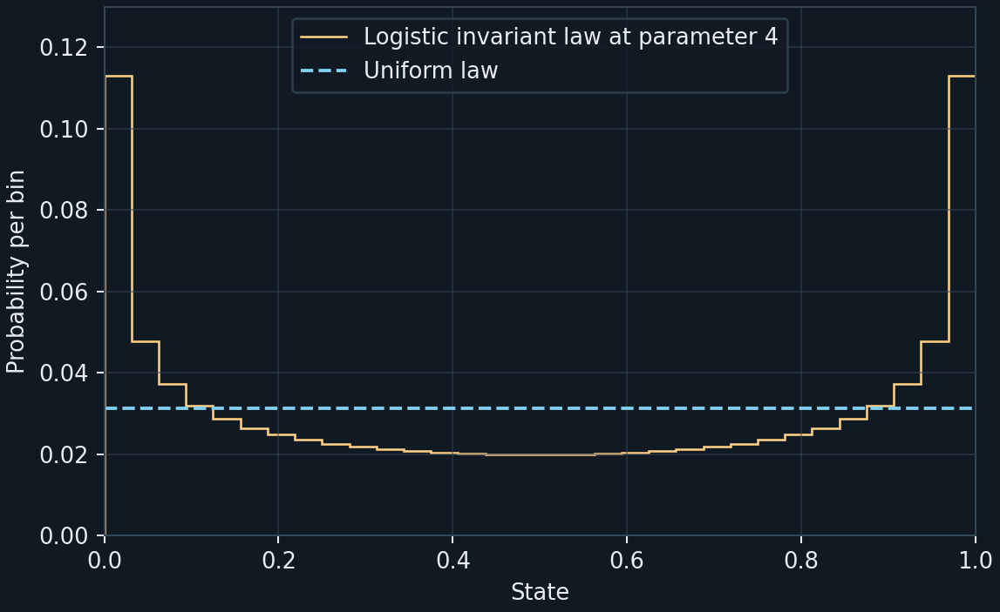

# What survives coarse graining?

A detector observing a deterministic map reports only a bin label at each step. Its output passes a frequency test for fair coin tosses. Does this establish a source of physical randomness? If we increase the number of bins, what additional properties of the underlying dynamics become measurable? We will use the binary shift and the logistic map to distinguish three questions: whether an itinerary determines the initial point, how stationary mass is distributed across bins, and whether a model for the sequence of bin labels has memory.

## Binary itineraries encode an initial point ([L21 01:32](https://www.youtube.com/watch?v=Haxy2Mh2GQ8&t=92s))

For $x\in[0,1)$ define the doubling map $T(x)=2x-\lfloor 2x\rfloor$, where the floor returns the largest integer no greater than its input. Give the two half intervals labels $0$ and $1$. The label of $T^{j-1}(x)$, the point after $j-1$ iterates, is the $j$th binary digit $b_j$ of $x$:

$$
x=\sum_{j=1}^{\infty}b_j2^{-j}.
$$

Multiplication by two moves the first digit to the integer part. Subtracting the floor removes it and leaves the tail. Use the terminating expansion at points with two binary representations. For example, the source state $5/8$ gives the labels $1,0,1,0,\ldots$. Any particular string of $n$ labels specifies an interval of length $2^{-n}$. Since these nested intervals have diameters tending to zero, the infinite itinerary recovers the initial state. This is a **generating partition** in the sense used here, up to null sets or the fixed endpoint convention.

If the initial $x$ is uniform, every word of length $n$ has probability $2^{-n}$, the product of the individual probabilities $1/2$. The symbols are then independent and identically distributed under the ensemble. A known initial point fixes all future outputs. Fixed inputs can give very different records, including eventual zeros for every dyadic rational. Independence is a property of a joint law with a specified initial ensemble. Tests of finite block frequencies cannot by themselves identify the mechanism that produced the record. The discussion of digits of $\pi$ illustrates this distinction. Observed frequencies in a finite prefix leave the assertion of asymptotic normality unresolved.

## Cell masses distinguish geometry from probability ([L21 14:01](https://www.youtube.com/watch?v=Haxy2Mh2GQ8&t=841s))

A probability measure $\mu$ is **invariant** for $T$ if $\mu(T^{-1}B)=\mu(B)$ for every measurable set $B$. Invariance says the fraction of an ensemble in a fixed region is stationary, even while individual points move. For the doubling map the two preimage branches each shrink length by $1/2$, so Lebesgue probability on $[0,1)$ is invariant.

Partition space at dimensionless length scale $\epsilon$ and write $m_j=\mu(B_j)$ for the probability of cell $B_j$. Sum only over cells with positive probability. For real $q\ne1$ the generalized dimension, when the limit exists, is

$$
D_q=\lim_{\epsilon\downarrow0}\frac{\log\sum_j m_j^q}{(q-1)\log\epsilon}.
$$

Hentschel and Procaccia develop this family for invariant measures of fractals and strange attractors. The case $q=0$ counts occupied cells. Large positive orders weight dense cells, and negative orders weight sparse occupied ones. Here statistical dimensions use the measure's occupied-cell convention, with regular grids or equivalent aligned counts for the explicit self-similar examples. A finite sample may wrongly assign zero mass to a cell and thereby profoundly affect negative-order estimates. [Hentschel and Procaccia (1983)](https://www.sciencedirect.com/science/article/pii/016727898390235X)

For any fixed partition, $\sum_j m_j=1$ implies that the numerator vanishes at $q=1$. Its derivative with respect to $q$ there is $\sum_j m_j\log m_j$. Taking $q\to1$ at fixed resolution gives the information-dimension formula

$$
D_1=\lim_{\epsilon\downarrow0}\frac{-\sum_j m_j\log m_j}{\log(1/\epsilon)}.
$$

The two limits require separate analysis. The calculation defines the entropy-based quantity without assuming that switching their order is valid. If $\epsilon=1/n$ and $m_j=1/n$, then $\sum_j m_j^q=n^{1-q}$ and $-\sum_jm_j\log m_j=\log n$. Thus every dimension in this example equals one.

## Fractal length and box dimension ([L21 28:00](https://www.youtube.com/watch?v=Haxy2Mh2GQ8&t=1680s))

The **box-counting dimension** uses the growth of the number $N(\epsilon)$ of boxes of side $\epsilon$ intersecting a set. When a limiting dimension exists, it is the limiting ratio $\log N(\epsilon)/\log(1/\epsilon)$. In a self-similar construction with separated copies or only controlled boundary overlap, replacing each piece by $a$ pieces scaled by a factor $r<1$ gives comparable counts $N(r^k)\asymp a^k$. Here $\asymp$ means both ratios are bounded by positive constants independent of the construction step $k$. The dimension is $\log a/\log(1/r)$.

The Koch arc replaces each line segment by four segments one third as long. At level $k$ the polygonal length is $(4/3)^k$ times the original length. Its blowup and the limit's box dimension $\log4/\log3$ express different facts. The length adds up lengths at a particular resolution. The dimension is the slope governing the change in the count from one resolution to the next. The middle-third Cantor set has two copies scaled by $1/3$, hence dimension $\log2/\log3$, and it has zero length, since the $k$th covering has length $(2/3)^k$. Equal weights on the two copies assign exactly $2^{-k}$ probability to each level-$k$ interval, making every $D_q$ equal to its box dimension for these aligned partitions.

## The logistic map changes scaling at order two ([L22 00:13](https://www.youtube.com/watch?v=NQ478COyIQs&t=13s))

Take $F(x)=4x(1-x)$ on $[0,1]$. The monotone transformation $x=\sin^2(\pi y/2)$ sends the symmetric tent map on $[0,1]$ to $F$. On the left branch the tent doubles $y$ and on the right it sends $y$ to $2-2y$. Either branch gives $F(\sin^2(\pi y/2))=\sin^2(\pi y)$ after applying the transformation. The tent map's invariant law is uniform in $y$. On $0<y<1$, the derivative $dx/dy=\pi\sin(\pi y/2)\cos(\pi y/2)=\pi\sqrt{x(1-x)}$ makes its probability per unit $x$ equal to $dy/dx$. The resulting density is

$$
\rho(x)=\frac{1}{\pi\sqrt{x(1-x)}},\qquad 0<x<1.
$$

In the recording the open interval is split into equal cells and the singular ends are treated separately. To make the scaling independent of quadrature error, integrate the density over each cell. Let $h=1/n$ and let cell $j$ be $[(j-1)h,jh]$ with endpoint conventions irrelevant to the integrals. For $j\le n/2$ the factor $(1-x)^{-1/2}$ lies between $1$ and $\sqrt{2}$. Since

$$
\int_{(j-1)h}^{jh} x^{-1/2}\,dx=
2\sqrt h\,(\sqrt j-\sqrt{j-1})=
\frac{2\sqrt h}{\sqrt j+\sqrt{j-1}},
$$

we have $m_j\asymp n^{-1/2}j^{-1/2}$, with mirror masses at the other end. For any fixed real $q$, raising to $q$ preserves comparability with adjusted constants. Consequently $\sum_jm_j^q\asymp n^{-q/2}\sum_{j=1}^{\lfloor n/2\rfloor}j^{-q/2}$. The sum grows as $n^{1-q/2}$ for $q<2$, as $\log n$ for $q=2$, and stays bounded for $q>2$. Therefore

$$
D_q=
\begin{cases}
1,&q\le2,\\[2pt]
q/[2(q-1)],&q>2.
\end{cases}
$$

At $q=2$ the correction $\log\log n/\log n$ decays slowly. To justify the $q=1$ value directly, let $\rho_h=m_j/h$ on cell $j$. The entropy is $\log n-\int_0^1\rho_h\log\rho_h\,dx$. The integral is nonnegative by Jensen's inequality and at most $\int_0^1\rho\log\rho\,dx$ by applying the same convexity within each cell. This upper bound is finite because $x^{-1/2}|\log x|$ is integrable near zero and the right end is symmetric. Dividing by $\log n$ proves $D_1=1$.

The uniform tent and the logistic map are related by a coordinate change that compresses positions quadratically near the ends. This is why their support dimensions agree and the high-order generalized dimensions differ. The measurement coordinate is part of the dimension experiment. More generally, if $\rho(x)$ behaves as $c x^\alpha$ near an endpoint with $\alpha>-1$ and is bounded above and bounded away from zero outside an endpoint neighborhood, then $m_j\asymp n^{-(1+\alpha)}j^\alpha$ near that end. The moment changes scaling near $\alpha q=-1$. A density vanishing at an endpoint ($\alpha>0$) creates the transition on the negative-order side. A divergence ($-1<\alpha<0$) creates it at positive order.

<figure>

<figcaption>Exact integration of the logistic map's arcsine invariant law across 32 equal-width bins. The end bins carry more mass than the uniform law.</figcaption>
</figure>

## A Markov law specifies conditional evolution ([L22 28:24](https://www.youtube.com/watch?v=NQ478COyIQs&t=1704s))

Let $X_t$ be the observable state at time $t$ and $K_{s,t}(x,B)$ the conditional probability of $X_t$ belonging to set $B$ given $X_s=x$. A first-order Markov law says that, conditional on the present, earlier observations do not change the future conditional distribution. The ordinary chain rule for joint probabilities then factors a time-ordered joint law into an initial law times successive transition probabilities. In discrete states and homogeneous discrete time the joint mass of $i_0,\ldots,i_n$ is $p_{i_0}(0)\prod_{k=1}^n P_{i_k i_{k-1}}$, where $P_{ij}=\Pr(X_{k+1}=i\mid X_k=j)$.

Time homogeneity means a transition depends only on elapsed time. Stationarity means the joint laws are invariant under a common time shift. A homogeneous chain started with an arbitrary law can have changing one-step marginals. It becomes stationary when started with an invariant law. Convergence to an invariant law from arbitrary starts is a further property, illustrated by the two-state model in [Chapter 11](ch11.html).

For times $s<u<t$, condition on the intermediate state $y$ and apply the Markov property to obtain the Chapman–Kolmogorov law

$$
K_{s,t}(x,B)=\int K_{u,t}(y,B)\,K_{s,u}(x,dy).
$$

For discrete state spaces the integral is a sum. This is the rule behind matrix powers and the short-time generator limit in the next section. Its applicability to measured bins still needs checking. A hidden point inside a bin can carry information from earlier observations. A generating itinerary alone does not guarantee absence of this projected memory. [Kolmogorov (1931)](https://link.springer.com/article/10.1007/BF01457949)

## Probability gain, loss, and time scale ([L22 49:01](https://www.youtube.com/watch?v=NQ478COyIQs&t=2941s))

For a finite-state homogeneous jump process, define $w_{ij}\ge0$ for $i\ne j$ by the small-time probability $w_{ij}\,\Delta t+o(\Delta t)$ to move from $j$ to $i$. The notation $o(\Delta t)$ means the error divided by $\Delta t$ tends to zero. The probability of staying in $j$ to first order is $1-\Delta t\sum_{i\ne j}w_{ij}$. Set $w_{jj}=-\sum_{i\ne j}w_{ij}$ and gather the rates in a matrix $W$. Using the transition law for a column vector $p(t)$ gives

$$
\dot p_i=\sum_{j\ne i}w_{ij}p_j-\sum_{j\ne i}w_{ji}p_i,\qquad
p(t)=e^{Wt}p(0).
$$

The second equation solves the first by differentiating the matrix exponential and using $p(0)$ as the initial condition. The columns of $W$ sum to zero, so summing the gain and loss equations gives $\frac{d}{dt}\sum_i p_i=0$. Rates carry units of inverse time, while $P$ is dimensionless. In a discrete step model, multiplying by $P$ advances a probability vector by one full step. The corresponding formula is $p(n)=P^n p(0)$.

## Laboratory

Run [the cell-mass laboratory](../code/ch10.py) with Python. It uses the exact arcsine cumulative probability $2\arcsin(\sqrt{x})/\pi$ and evaluates bin masses from the left before reflecting them. This avoids subtracting values close to one at the right end. It checks positivity, normalization, and growth of the endpoint mass coefficient. At 65,536 bins it reports finite-scale estimates $0.978358$, $0.899271$, and $0.698362$ for orders $1,2,4$. The limits are $1,1,2/3$. In particular, a finite-scale estimate near $0.9$ at order two does not justify replacing the analytic endpoint calculation.

## Exercises

1. **Recover an interval.** The binary itinerary starts $1011$. Give its allowed interval and its probability under the uniform initial ensemble.
2. **Check endpoint scaling.** Derive the leading small-$h$ mass of the first logistic bin and compare it with a bin centered near $1/2$.
3. **Compute a dimension family.** Assign left and right weights $p$ and $1-p$ to each copy in a Cantor construction, with $0<p<1$. Find $D_q$ for the construction intervals at level $k$ and check the equal-weight case.
4. **Separate homogeneity and stationarity.** Use a matrix with identical columns $(3/4,1/4)^T$ to construct a homogeneous trajectory law whose initial marginal is different from its later marginals.
5. **Stress-test the Markov assumption.** Consider a dynamical system running periodically through symbols $0,0,1$. Let its initial phase be uniform. Does its stationary symbol process satisfy the first-order Markov property?

Worked solutions

1. The binary integer corresponding to the word is $8+2+1=11$. The unobserved tail moves the state in $[11/16,12/16)$ under the terminating convention. Its length and probability are both $1/16$.
2. As $h\downarrow0$, $(1-x)^{-1/2}\to1$ uniformly on the first bin, and integrating $1/(\pi\sqrt{x})$ gives $2\sqrt h/\pi$. At the midpoint the density is continuous with value $2/\pi$, so the centered bin has mass asymptotic to $2h/\pi$. Their ratio grows as $h^{-1/2}$.
3. The moment is $(p^q+(1-p)^q)^k$ by multiplying all copy weights and summing over binary choices. With $\epsilon=3^{-k}$ this gives $D_q=\log(p^q+(1-p)^q)/[(1-q)\log3]$ for $q\ne1$. The derivative at one gives $D_1=-(p\log p+(1-p)\log(1-p))/\log3$. If $p=1/2$ every expression reduces to $\log2/\log3$.
4. Start with $p(0)=(1,0)^T$. Matrix multiplication gives $p(1)=(3/4,1/4)^T$. Each further multiplication produces the same vector because its coordinates sum to one. The step law is constant even though the initial state distribution changes.
5. Given symbol $0$, the next is $1$ with probability $1/2$. But a $0$ preceded by $1$ is the first $0$, so the next symbol is $0$ with certainty. A $0$ preceded by $0$ is the second $0$, so the next symbol is $1$ with certainty. Marginal stationarity has not removed hidden phase memory.

## Sources and continuation

- [Original lectures 21–22](../source-map.html#l21)
- [Hentschel and Procaccia, generalized dimensions](https://www.sciencedirect.com/science/article/pii/016727898390235X)
- [Kolmogorov, analytical methods of probability theory](https://link.springer.com/article/10.1007/BF01457949)
- [Chapter 11](ch11.html) uses a partition to compute first-return statistics.
